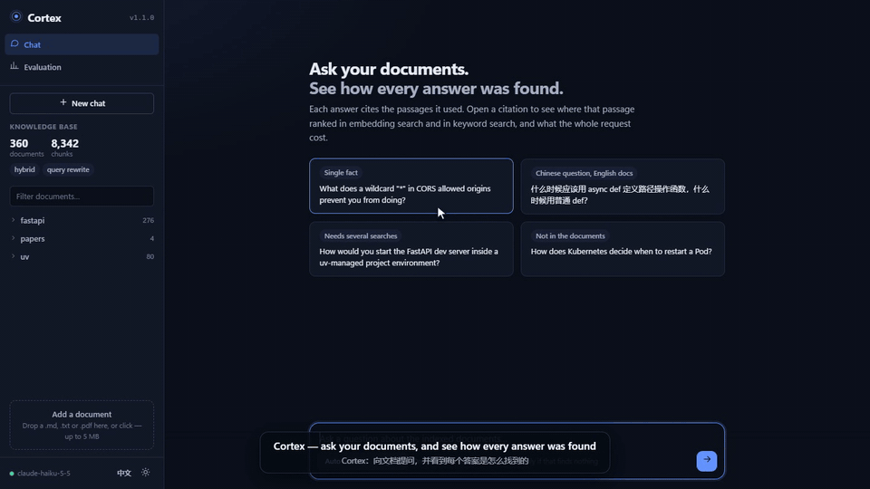
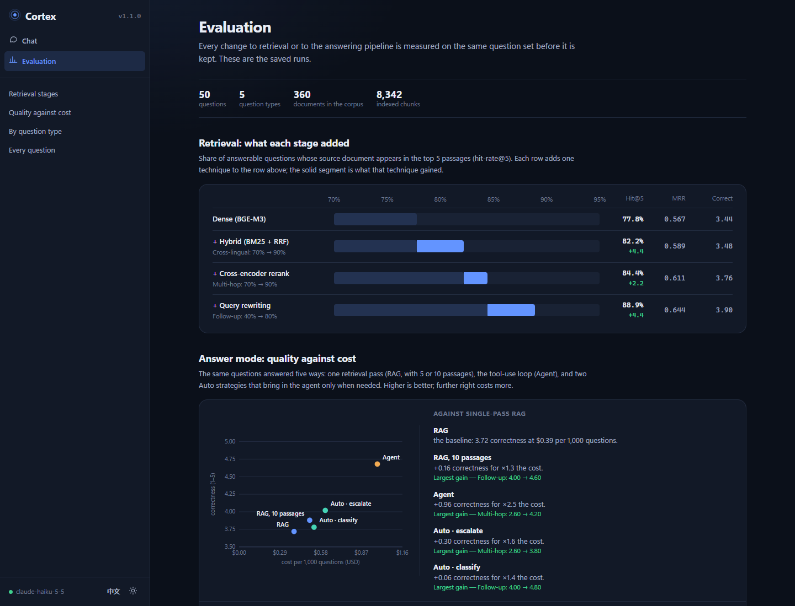
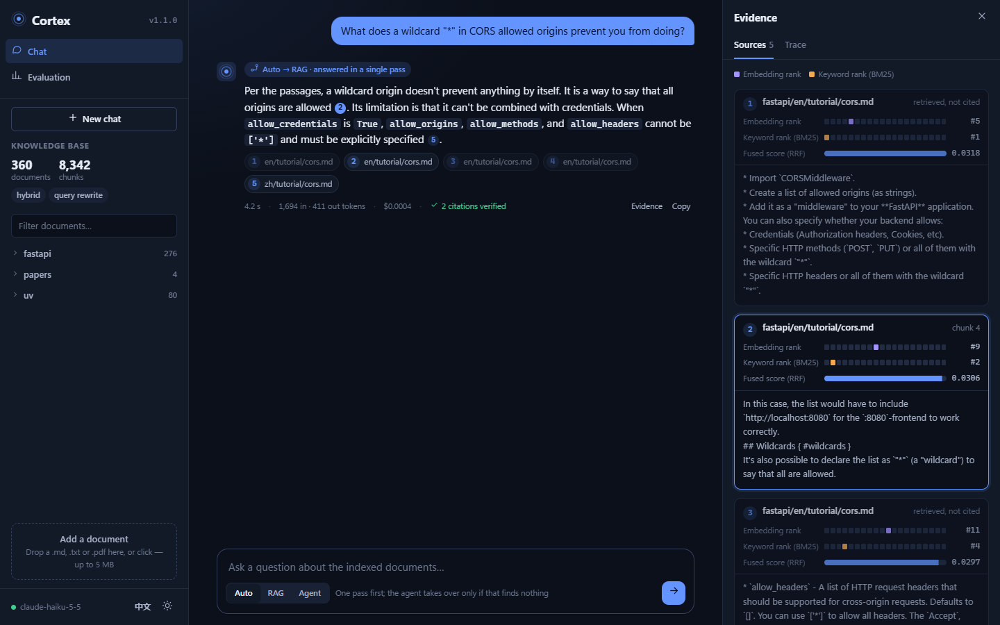
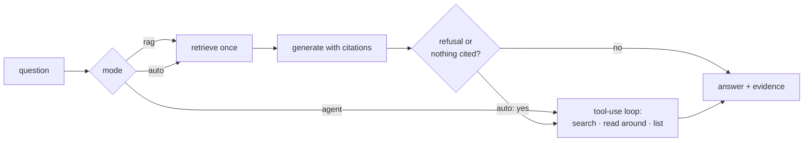

# Cortex

[](https://github.com/ALTERLK/cortex/actions/workflows/ci.yml)
[](LICENSE)
[](pyproject.toml)

**English** · [简体中文](README.zh-CN.md)

An agentic RAG system that answers questions over your documents and shows
how each answer was found: the passages it cited, where each one ranked in
embedding and keyword search, and what the request cost.

Retrieval, the agent loop, and the evaluation harness are written directly
against an LLM API, with no RAG or agent framework. Every change is
measured on the same 50 questions before it is kept.



<sub>The full two-minute walkthrough is attached to the
[latest release](https://github.com/ALTERLK/cortex/releases/latest).</sub>

## What it does

- **Cited answers.** Every claim points at a passage; a deterministic check
  flags citation numbers that match no source.
- **Hybrid retrieval.** Embeddings (BGE-M3) and a hand-written BM25 fused by
  reciprocal rank, with optional cross-encoder reranking and rewriting of
  follow-up questions. Chinese questions work over English documents.
- **An agent that searches for itself.** A tool-use loop with a tool
  registry, citation numbers that stay stable across searches, a token
  budget, and compaction of old tool results.
- **Evidence for each answer.** The UI shows each passage's rank in both
  retrievers, its fused and rerank scores, and a timed trace of the request.
- **An evaluation harness** that scores retrieval, answer correctness,
  refusals and citations, and records tokens, latency and cost per question.
- **Runs locally.** Embedding and search are on your machine; the only
  network dependency is the LLM, through any OpenAI-compatible endpoint.

## Measured

50 questions in five categories over 360 documents (FastAPI docs in English
and Chinese, uv docs, four papers — 8,342 chunks). Model: `claude-haiku-5-5`.
Full method, per-category results and limitations: [docs/evaluation.md](docs/evaluation.md).

**Retrieval — what each stage added**

| Configuration | Hit-rate@5 | MRR | Correctness | Biggest gain |
|---|---|---|---|---|
| Dense (BGE-M3) | 77.8% | 0.567 | 3.44 | — |
| + Hybrid (BM25 + RRF) | 82.2% | 0.589 | 3.48 | cross-lingual 70% → 90% |
| + Cross-encoder rerank | 84.4% | 0.611 | 3.76 | multi-hop 70% → 90% |
| + Query rewriting | **88.9%** | **0.644** | **3.90** | follow-up 40% → 80% |

**Answer mode — quality against cost**

| Mode | Correctness | Multi-hop | Cost / 1,000 questions | Latency | Sent to agent |
|---|---|---|---|---|---|
| RAG, 5 passages | 3.72 | 2.6 | $0.39 | 3.2 s | — |
| RAG, 10 passages | 3.88 | 2.6 | $0.50 | 4.4 s | — |
| Agent | **4.68** | **4.2** | $0.99 | 5.5 s | 100% |
| Auto — escalate on failure *(default)* | 4.02 | 3.8 | $0.61 | 4.4 s | 22% |
| Auto — classify first | 3.78 | 2.6 | $0.53 | 4.7 s | 4% |

Three things the numbers say:

- **The agent is the one change that moves multi-hop questions** (2.6 →
  4.2), at 2.5× the cost. Passing ten passages to a single call raised
  hit-rate to 93% and left multi-hop correctness where it was.
- **Routing up front did not work.** A classifier that picks the hard
  questions sent 4% of them to the agent and gained nothing, while adding a
  call to every request. It is kept, selectable, to re-run the test.
- **Escalating on failure recovers about a third of the gap** for 57% extra
  cost. Five of its eleven escalations were unanswerable questions that RAG
  had already refused correctly, which no cheap check can tell apart.



## Quickstart

Requires Python 3.12+ and [uv](https://docs.astral.sh/uv/).

```sh
uv sync                                   # install
copy .env.example .env                    # set LLM_API_KEY, LLM_BASE_URL, LLM_MODEL
uv run python scripts/fetch_corpus.py     # optional: fetch the 360-document demo corpus
uv run python scripts/ingest.py corpus    # build the index (downloads BGE-M3, ~2.3 GB, once)
```

Then start it — `start.bat` on Windows, `./start.sh` on macOS/Linux:

```sh
start.bat
```

The launcher checks the key, the index, the model cache and the provider,
picks a free port, and opens the browser. To try it without the corpus,
index the sample document instead: `uv run python scripts/ingest.py examples`.

Tests run offline, with no API key: `uv run pytest`.



## How it works



- `rag` retrieves once and answers. Fast and cheap.
- `agent` lets the model plan its own searches and read around a hit.
- `auto` answers with `rag` and hands over to the agent only when that
  answer is a refusal or cites nothing.

[docs/architecture.md](docs/architecture.md) covers ingest, retrieval,
the agent loop, streaming and the evaluation harness.

## Project layout

```
src/cortex/
├── llm/        provider-agnostic client protocol, OpenAI-compatible adapter
├── ingest/     loader, chunker, embedder, vector store
├── rag/        retrievers, generator, query rewriter, citation check
├── agent/      tool registry, tool-use loop, router, run trace
├── eval/       dataset, metrics, pipelines, runner, injection benchmark
├── api/        FastAPI app and the web UI (static, no build step)
└── mcp_server.py
benchmarks/     the eval set and every saved run
scripts/        ingest, serve, launcher, evaluation, checks
examples/       command-line examples
docs/           architecture, decisions, evaluation, deployment, roadmap
```

## API

| Endpoint | Purpose |
|---|---|
| `POST /ask` · `POST /ask/stream` | Answer a question (`mode`: `auto` · `rag` · `agent`), as JSON or Server-Sent Events |
| `GET /stats` · `GET /documents` | What is indexed |
| `PUT /documents/{name}` · `DELETE /documents/{source}` | Upload and index a document; remove an uploaded one |
| `POST /ingest` · `GET /ingest/{job}` | Index a directory in the background; poll progress |
| `GET /eval/results` | Saved evaluation runs, summarised |

Interactive reference at `/docs` when the server is running.

## MCP server

The same retrieval is available to MCP clients as two tools,
`search_knowledge_base` and `ask_knowledge_base`:

```sh
uv run python scripts/check_mcp.py     # a real stdio round trip
```

Register `uv run --directory <path-to-repo> python scripts/mcp_serve.py`
with your MCP client; a project-scope [`.mcp.json`](.mcp.json) is included.

## Documentation

- [Architecture](docs/architecture.md) — how the parts fit
- [Design decisions](docs/decisions.md) — what was chosen over what, and why
- [Evaluation](docs/evaluation.md) — method, results, limitations
- [Deployment](docs/deployment.md) — local launcher, Docker, public demo
- [Roadmap](docs/roadmap.md)

## Limitations

- Correctness is graded by the same model that answers, on 50 questions;
  treat differences under about 0.2 as noise.
- The agent's final answer is not streamed token by token.
- Reranking adds about ten seconds per query on CPU and is off by default.
- One process only: the index, the rate limits and the job table are local.
- The Docker image and the public-demo build have not been run yet.

## License

[MIT](LICENSE)
