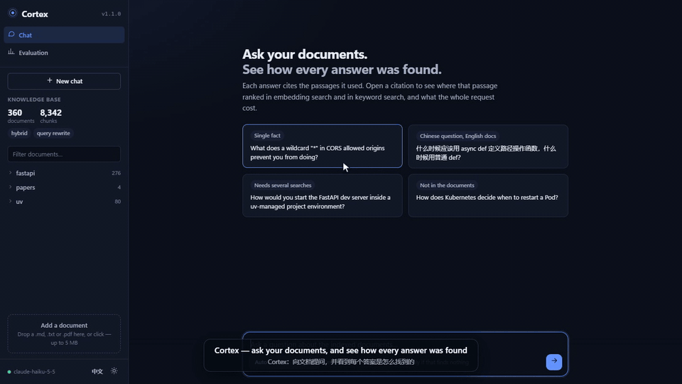
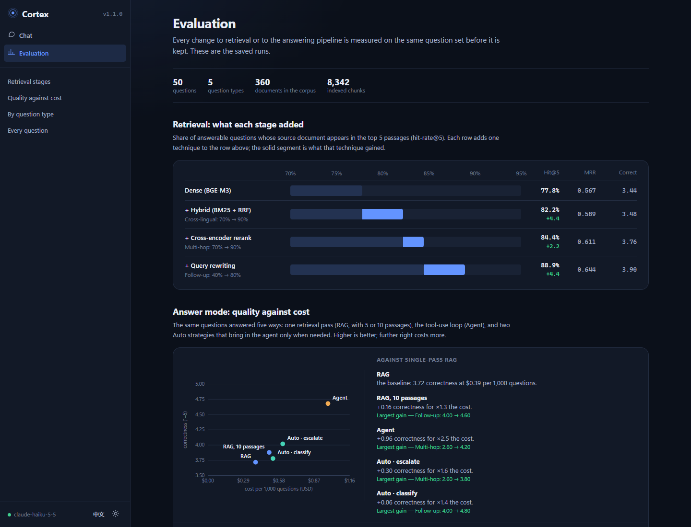
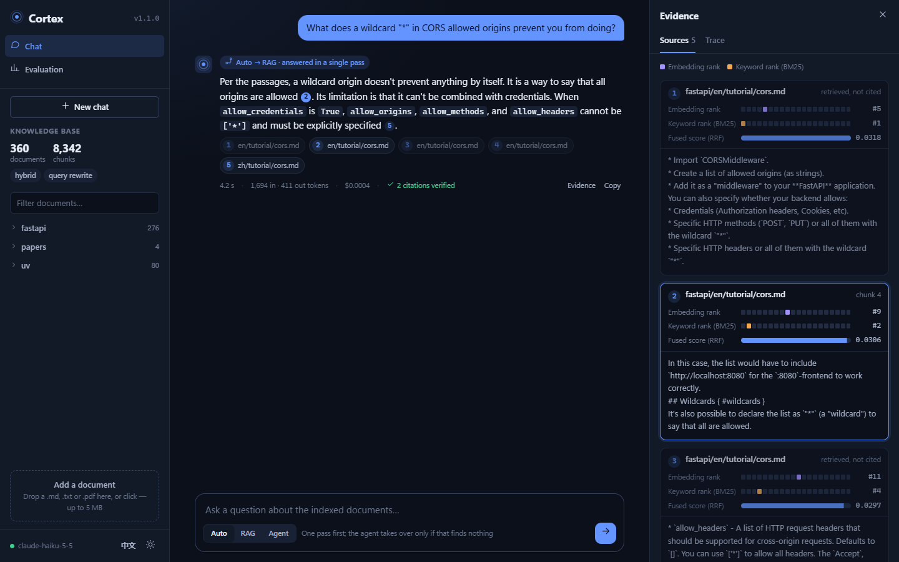
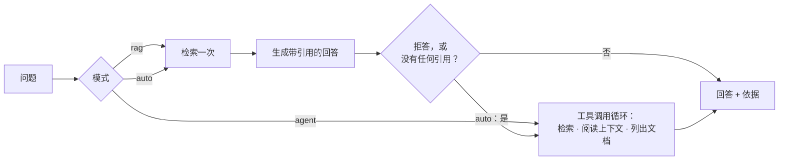

# Cortex

[](https://github.com/ALTERLK/cortex/actions/workflows/ci.yml)
[](LICENSE)
[](pyproject.toml)

[English](README.md) · **简体中文**

一个 Agentic RAG 系统：针对你自己的文档回答问题，并展示每个答案是怎么得出的——
引用了哪些段落、每个段落在向量检索和关键词检索中各排第几、这次请求花了多少。

检索、Agent 循环和评测框架都是直接基于 LLM API 手写的，没有使用任何 RAG 或 Agent 框架。
每一处改动都先在同一套 50 道题上量过，再决定是否保留。



<sub>完整的两分钟演示视频见
[最新 Release](https://github.com/ALTERLK/cortex/releases/latest) 的附件。</sub>

## 功能

- **带引用的回答。** 每个结论都指向具体段落；确定性的校验会标出指向不存在来源的引用编号。
- **混合检索。** 向量检索（BGE-M3）与手写 BM25 用倒数排名融合（RRF），可选交叉编码器重排，
  追问会先改写成完整查询。支持用中文提问英文文档。
- **会自己检索的 Agent。** 手写的工具调用循环：工具注册表、跨多次检索保持稳定的引用编号、
  token 预算，以及对旧工具结果的上下文压缩。
- **每个答案的依据。** 界面展示每个段落在两路检索中的排名、融合得分和重排得分，
  以及整个请求的分步耗时。
- **评测框架。** 对检索、回答正确性、拒答和引用分别打分，并记录每道题的 token、耗时和成本。
- **本地运行。** 向量化和检索都在本机完成；唯一的网络依赖是 LLM，
  可接入任何兼容 OpenAI 接口的服务。

## 实测结果

360 篇文档（FastAPI 中英文文档、uv 文档、四篇论文，共 8,342 个分块）上的 50 道题，分五种题型。
模型：`claude-haiku-5-5`。完整方法、分题型结果与局限见 [docs/evaluation.md](docs/evaluation.md)。

**检索：每一步带来了什么**

| 配置 | Hit-rate@5 | MRR | 正确性 | 提升最大的题型 |
|---|---|---|---|---|
| 向量检索（BGE-M3） | 77.8% | 0.567 | 3.44 | — |
| + 混合检索（BM25 + RRF） | 82.2% | 0.589 | 3.48 | 跨语言 70% → 90% |
| + 交叉编码器重排 | 84.4% | 0.611 | 3.76 | 多跳 70% → 90% |
| + 查询改写 | **88.9%** | **0.644** | **3.90** | 追问 40% → 80% |

**回答模式：质量与成本**

| 模式 | 正确性 | 多跳题 | 每千题成本 | 延迟 | 交给 Agent 的比例 |
|---|---|---|---|---|---|
| RAG，5 段 | 3.72 | 2.6 | $0.39 | 3.2 s | — |
| RAG，10 段 | 3.88 | 2.6 | $0.50 | 4.4 s | — |
| Agent | **4.68** | **4.2** | $0.99 | 5.5 s | 100% |
| Auto — 失败时升级 *(默认)* | 4.02 | 3.8 | $0.61 | 4.4 s | 22% |
| Auto — 先分类 | 3.78 | 2.6 | $0.53 | 4.7 s | 4% |

数据说明了三件事：

- **只有 Agent 能显著改善多跳题**（2.6 → 4.2），代价是 2.5 倍成本。
  一次调用塞进 10 个段落，命中率升到 93%，多跳题的正确性却原地不动。
- **事先分类路由没有奏效。** 分类器只把 4% 的问题交给 Agent，几乎没有提升，
  却给每个请求多加了一次调用。代码保留并可选，方便重做这个对比。
- **失败时升级只追回约三分之一的差距**，额外成本 57%。11 次升级里有 5 次是
  RAG 本来已经正确拒答的无解题——廉价的检查分辨不出"正确拒答"和"答不出来"。



## 快速开始

需要 Python 3.12+ 和 [uv](https://docs.astral.sh/uv/)。

```sh
uv sync                                   # 安装依赖
copy .env.example .env                    # 填写 LLM_API_KEY、LLM_BASE_URL、LLM_MODEL
uv run python scripts/fetch_corpus.py     # 可选：获取 360 篇演示语料
uv run python scripts/ingest.py corpus    # 构建索引（首次会下载 BGE-M3，约 2.3 GB）
```

然后启动——Windows 用 `start.bat`，macOS/Linux 用 `./start.sh`：

```sh
start.bat
```

启动器会依次检查密钥、索引、模型缓存和 LLM 服务是否可用，自动选择空闲端口并打开浏览器。
不想下载语料的话，可以只索引示例文档：`uv run python scripts/ingest.py examples`。

测试完全离线、不需要 API key：`uv run pytest`。



## 工作原理



- `rag`：检索一次后直接作答，最快最省。
- `agent`：由模型自己规划多次检索，并可以阅读命中段落的上下文。
- `auto`：先用 `rag` 作答，只有当回答是拒答或没有任何引用时才交给 Agent。

入库、检索、Agent 循环、流式输出和评测框架的细节见 [docs/architecture.md](docs/architecture.md)。

## 项目结构

```
src/cortex/
├── llm/        与厂商无关的客户端协议、OpenAI 兼容适配器
├── ingest/     加载、切块、向量化、向量库
├── rag/        检索器、生成器、查询改写、引用校验
├── agent/      工具注册表、工具调用循环、路由、运行链路
├── eval/       数据集、指标、链路抽象、运行器、提示注入评测
├── api/        FastAPI 应用与 Web 界面（纯静态，无构建步骤）
└── mcp_server.py
benchmarks/     评测集与每一次保存的评测结果
scripts/        入库、启动、一键启动器、评测、自检
examples/       命令行示例
docs/           架构、设计决策、评测、部署、路线图
```

## API

| 接口 | 用途 |
|---|---|
| `POST /ask` · `POST /ask/stream` | 回答问题（`mode`：`auto` · `rag` · `agent`），返回 JSON 或 SSE 流 |
| `GET /stats` · `GET /documents` | 查看已索引的内容 |
| `PUT /documents/{name}` · `DELETE /documents/{source}` | 上传并索引文档；删除已上传的文档 |
| `POST /ingest` · `GET /ingest/{job}` | 后台索引一个目录；轮询进度 |
| `GET /eval/results` | 已保存评测结果的汇总 |

服务启动后可在 `/docs` 查看交互式接口文档。

## MCP 服务

同样的检索能力以两个 MCP 工具的形式提供：`search_knowledge_base` 和 `ask_knowledge_base`。

```sh
uv run python scripts/check_mcp.py     # 一次真实的 stdio 往返测试
```

在你的 MCP 客户端中注册 `uv run --directory <仓库路径> python scripts/mcp_serve.py`；
仓库内附带项目级的 [`.mcp.json`](.mcp.json)。

## 文档

- [架构](docs/architecture.md) — 各部分如何配合
- [设计决策](docs/decisions.md) — 选了什么、放弃了什么、为什么
- [评测](docs/evaluation.md) — 方法、结果与局限
- [部署](docs/deployment.md) — 本地启动器、Docker、公开演示
- [路线图](docs/roadmap.md)

（`docs/` 下的文档为英文。）

## 局限

- 正确性由回答问题的同一个模型打分，且只有 50 道题；小于约 0.2 的差异应视为噪声。
- Agent 的最终回答不是逐字流式输出的。
- 重排在 CPU 上每次查询约增加 10 秒，默认关闭。
- 仅支持单进程：索引、限流计数和任务表都在本地。
- Docker 镜像和公开演示的构建尚未实际运行过。

## 许可证

[MIT](LICENSE)
