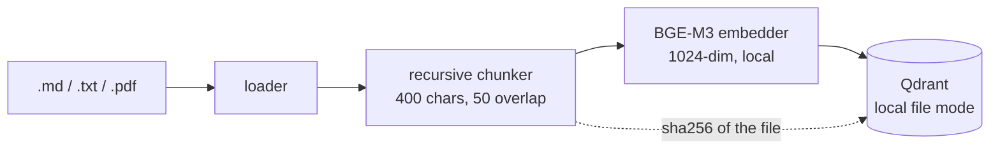
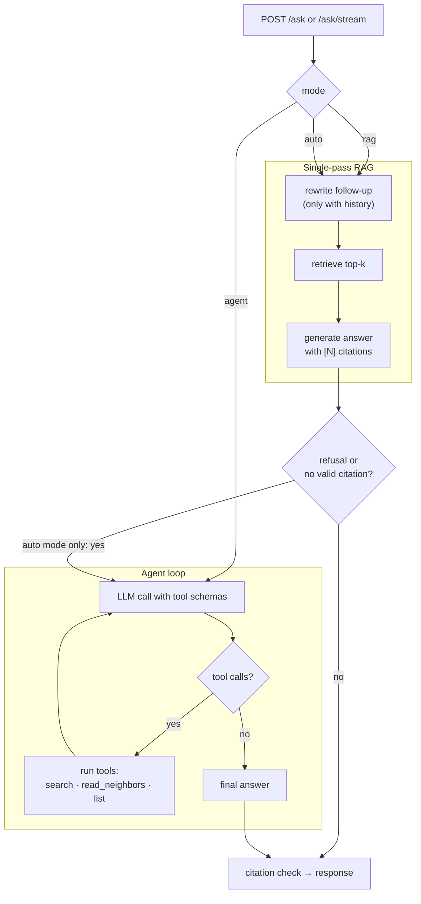
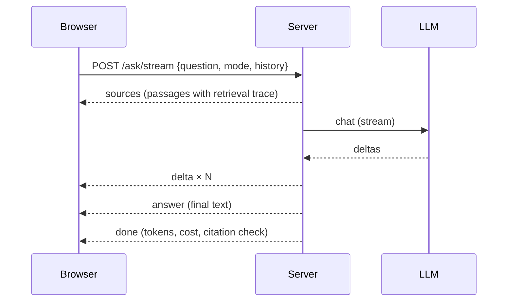
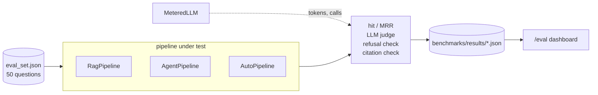

# Architecture

Cortex answers questions over a document collection and shows, for every
answer, which passages it used and how they were found. It has three parts
that share one set of components: an **ingest** path that builds the index,
a **query** path that answers questions, and an **evaluation** harness that
measures the query path.

```
src/cortex/
├── llm/      provider-agnostic client protocol, OpenAI-compatible adapter, usage meter
├── ingest/   loader → chunker → embedder → vector store
├── rag/      retrievers (dense, hybrid, reranking), generator, rewriter, citation check
├── agent/    tool registry, tool-use loop, router, run trace
├── eval/     dataset, metrics, pipelines, runner, injection benchmark
├── api/      FastAPI app: ask, knowledge base, evaluation; static web UI
└── mcp_server.py   the same retrieval exposed as MCP tools
```

## Ingest



Ingest is incremental. Each chunk stores the hash of the file it came from;
on a re-run an unchanged file is skipped, and a changed file has its old
chunks deleted before the new ones are written. Chunk ids are derived from
`(source, chunk_index)`, so writing the same chunk twice overwrites it.

Qdrant holds the only persistent index. The BM25 index used by hybrid
retrieval is built in memory from the chunks in Qdrant when the server
starts, and rebuilt whenever an ingest job changes them.

## Query

A request names a mode. `rag` and `agent` are the two pipelines; `auto`
decides between them per question.



### Retrieval

Three strategies, selected by `RETRIEVAL_MODE` and built by one factory
(`rag/factory.py`) that the server, the evaluation harness, and the MCP
server all call:

| Strategy | What it does |
|---|---|
| `dense` | Embed the query, nearest neighbours in Qdrant. |
| `hybrid` | Top 20 from dense and top 20 from BM25, merged by reciprocal rank fusion. |
| `hybrid_rerank` | The fused top 20 re-scored by a cross-encoder; the best 5 are kept. |

Every passage carries a `RetrievalTrace`: its rank in the dense list, its
rank in the BM25 list, its fused score, and its rerank score. The trace
travels with the passage to the API response, which is what lets the UI show
why a passage was retrieved.

### The agent loop

`agent/loop.py` is a `for` loop over LLM calls. Each turn sends the
conversation and the tool schemas; if the model asks for tools they are run
and their results appended; when it answers in text the loop ends.

- **Tools** are methods on `ToolExecutor` marked with `@tool`, which keeps
  each JSON schema next to its implementation. A bad call — unknown tool,
  wrong argument type, a crash inside the tool — is returned to the model as
  an error observation instead of raised.
- **Citations** are numbered per run. A `RunContext` created for each run
  gives every passage one number, so `[3]` means the same passage no matter
  which search returned it. The executor is shared by all requests; the
  context is what keeps concurrent runs apart.
- **Limits.** A step limit and a token budget end the run with a forced
  final answer. When the prompt grows past a threshold, older tool results
  are replaced by one-line stubs that keep their citation numbers.
- **Trace.** Each LLM call and tool call is recorded as a span with its
  duration and token usage.

### Auto mode

`auto` runs single-pass RAG first. If the answer is a refusal, or cites no
retrieved passage, the request is handed to the agent and the first pass is
discarded. Both conditions are detected by string checks, so the common
case costs exactly what RAG costs. A second strategy, in which one LLM call
classifies the question before anything runs, is kept for comparison; see
[evaluation.md](evaluation.md) for how the two measure up.

### Streaming

`/ask` and `/ask/stream` are two views of one generator that yields
`(event, payload)` pairs. The streaming endpoint forwards each pair as a
Server-Sent Event; the JSON endpoint folds them into one response.



The server keeps no conversation state. The browser sends the previous
turns with each request, and the server caps how many it forwards.

## Evaluation



The three pipelines share one interface, so a run measures any of them on
the same questions with the same metrics. The pipeline's LLM client is
wrapped in a meter that counts every call it makes; the judge uses an
unmetered client, so grading is not charged to the system under test.

## Cross-cutting

- **Provider independence.** Application code depends on the `LLMClient`
  protocol. One adapter (`llm/openai_compat.py`) speaks to any
  OpenAI-compatible endpoint and absorbs provider quirks — tool arguments as
  JSON strings, models that reject sampling parameters, missing usage data.
- **Configuration.** One `Settings` class reads environment variables and
  `.env`; nothing else reads the environment.
- **Observability.** Middleware gives each request an id and logs one JSON
  line per request. Handlers log tokens and cost. The id reaches every log
  line through a `ContextVar`.
- **Abuse limits.** An API key, a per-client sliding-window limit, a daily
  request budget, and a read-only switch — see [deployment.md](deployment.md).
